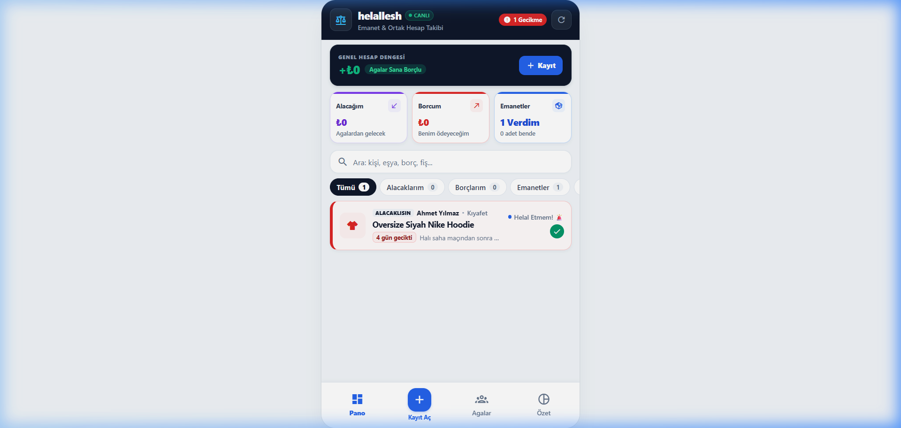
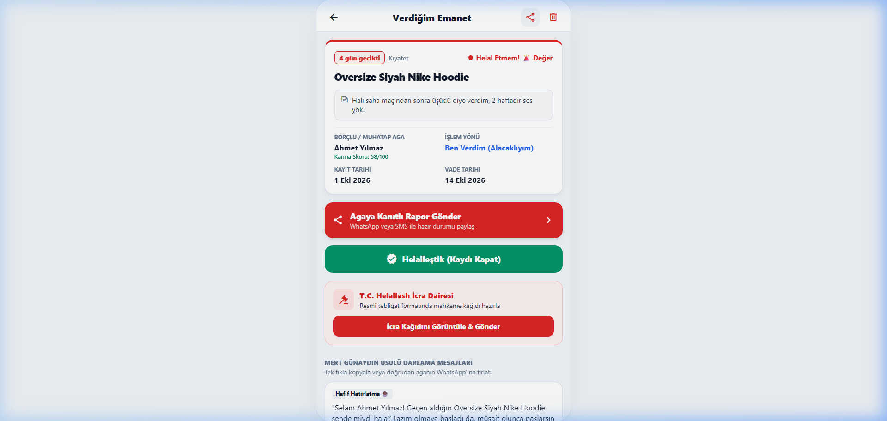
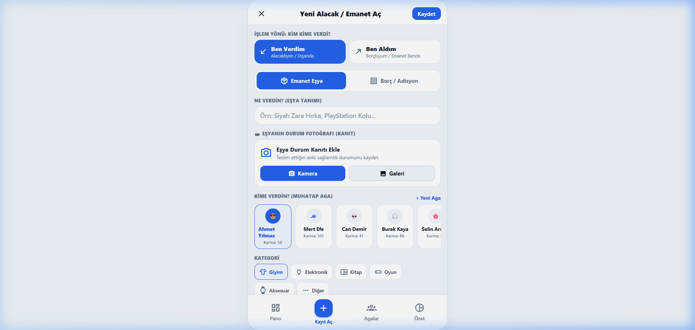
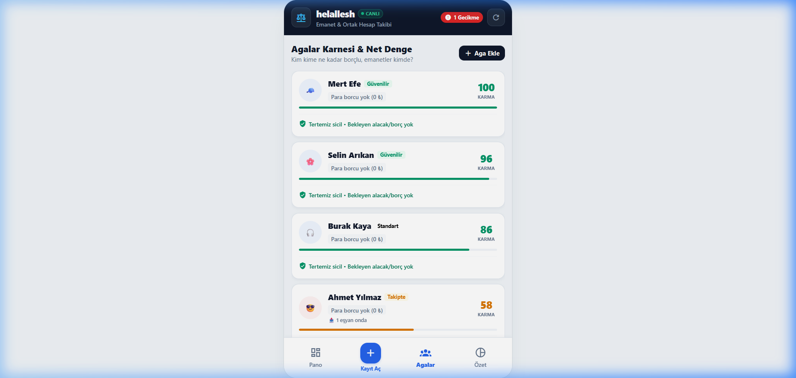
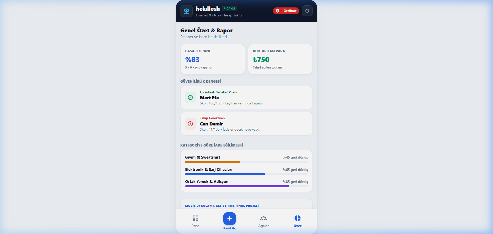

# ⚖️ Helallesh – P2P Item & Debt Justice Assistant
> *"Ne eşyan çökülsün, ne paran yansın!"*  
> **Course:** Mobile Application Development – Final Project  
> **Instructor:** Assist. Prof. Dr. Zeki Özen  
> **Student:** Mehmet Raşid (rasid / `mehmetrasid0`)  
> **Live Expo EAS Project:** [https://expo.dev/accounts/mehmetrasid0/projects/helallesh](https://expo.dev/accounts/mehmetrasid0/projects/helallesh)  
> **Repository:** [https://github.com/mehmetrasid0/helallesh](https://github.com/mehmetrasid0/helallesh)

---

## 📌 Table of Contents
1. [Overview & Problem Statement](#1-overview--problem-statement)
2. [Key Features](#2-key-features)
3. [Tech Stack & Architecture](#3-tech-stack--architecture)
4. [Screenshots & User Flow](#4-screenshots--user-flow)
5. [Setup & Run Instructions](#5-setup--run-instructions)
6. [Data Management & Persistence](#6-data-management--persistence)
7. [Git Commit Timeline](#7-git-commit-timeline)
8. [Course Rubric Compliance](#8-course-rubric-compliance)
9. [Deliverables & Documentation](#9-deliverables--documentation)

---

## 1. Overview & Problem Statement

In student life and close social circles, sharing things is constant: borrowed hoodies, textbooks, chargers, gaming controllers, and split dinner bills. However, asking a friend for money or items back feels awkward, leading to forgotten debts, lost belongings, and damaged relationships.

**Helallesh** solves this awkwardness through **comedy, transparency, and gamified peer accountability**:
- **Two-Way Balance Engine:** Tracks both money/items you lent (*Verdim / Alacak*) and debts you owe (*Aldım / Borç*), automatically consolidating them into a single **Net Balance**.
- **Photo Proofing:** Attach camera or gallery photos of receipts, bills, and item conditions.
- **Helallesh Legal Humor WhatsApp Tebligat Generator:** Replaces passive-aggressive messages with hilarious, hyper-formal legal summons (*"Ağır Ceza Mahkemesi İcra Tebligatı"*) dispatched straight to WhatsApp in one tap.
- **Helallik & Karma Score:** A dynamic 0–100 punctuality index measuring friend reliability.

---

## 2. Key Features

- **Dynamic Net Balance Hero:** Instantly displays whether friends owe you money (`+250 ₺ Agalar Sana Borçlu`) or you have outstanding debts (`-180 ₺ Agalara Borcun Var`).
- **Two-Way Transaction Flow:** Select between *Verdim (Alacaklıyım)* and *Aldım (Borçluyum)* with corresponding debtor settlement actions.
- **Camera & Receipt Attachments:** Uses `expo-image-picker` to capture physical proofs with thumbnail previews and full-screen zoom.
- **Helallesh Comedic Legal WhatsApp Summons:** 4 custom legalistic comedy templates sent via deep link directly to the recipient's WhatsApp chat.
- **Agalar (Friends) Matrix:** Per-person net balances, trust badges, and single-tap full debt settlement.
- **Helallik Analytics:** Visual charts showing return timeliness, total capital in circulation, and net position.
- **Offline-First Persistence:** Centralized React Context state engine synced to `@react-native-async-storage/async-storage`.

---

## 3. Tech Stack & Architecture

| Layer | Technology | Details |
|---|---|---|
| **Runtime & Framework** | **React Native & Expo (SDK 52)** | iOS, Android, and Web support |
| **Navigation** | **@react-navigation v7** | Native Stack & Bottom Tabs |
| **State Management** | **React Context API & Hooks** | Unidirectional data flow, reactive re-rendering |
| **Persistent Storage** | **AsyncStorage** | Local offline-first JSON document storage |
| **Hardware & Native API** | **expo-image-picker & Linking** | Camera/Gallery capture and native WhatsApp dispatch |
| **Design System** | **Modular Vanilla StyleSheet** | Slate `#F1F5F9`, Midnight Navy `#0F172A`, Royal Blue, Crimson, Violet |

### Directory Structure
```
helallesh/
├── assets/                  # App icon, splash screen, and static graphics
├── docs/                    # Final project report, presentation scripts, PDF materials
│   ├── PROJECT_REPORT.md    # Detailed project documentation & rubric mapping
│   ├── PRESENTATION_SCRIPT.md # 7-10 minute presentation guide (TR & EN)
│   └── PROJECT_REPORT.html  # Print-ready styled document for PDF generation
├── screenshots/             # High-resolution screenshots of all app screens
│   ├── 01_dashboard.png     # Dashboard with Net Balance & Filter tabs
│   ├── 02_item_detail.png   # Item Detail with Photo Proof & Tebligat
│   ├── 03_add_record.png    # Add Record Form with Two-Way toggle
│   ├── 04_friends.png       # Agalar (Friends) List with per-person balance
│   └── 05_karma_stats.png   # Helallik Skor & Financial Analytics
├── src/
│   ├── context/
│   │   └── ItemsContext.js  # Global state, AsyncStorage CRUD, recalculations
│   ├── data/
│   │   └── mockData.js      # Realistic initial seed data for instant evaluation
│   ├── screens/
│   │   ├── DashboardScreen.js # Main overview, balance banner, filterable cards
│   │   ├── AddItemScreen.js   # Two-way transaction form with image picker
│   │   ├── DetailScreen.js    # Record details, photo zoom modal, tebligat generator
│   │   ├── FriendsScreen.js   # Friends balance matrix & 1-tap settlement
│   │   └── StatsScreen.js     # Karma index, debt ratio, and return velocity
│   └── utils/
│       └── templates.js     # Legalistic comedic WhatsApp summon templates
├── App.js                   # Root navigator, tab bar configuration, Context Provider
├── app.json                 # Expo EAS configuration, project ID, permissions
├── package.json             # Dependencies and build scripts
└── start-lan.bat            # Auto-detecting LAN Metro launcher for mobile testing
```

---

## 4. Screenshots & User Flow

| 1. Dashboard (Pano) | 2. Record Detail & Tebligat | 3. Add Record (Kayıt Aç) |
|:---:|:---:|:---:|
|  |  |  |
| *Net Balance banner, filter pills & cards* | *Photo proof preview & WhatsApp summon* | *Two-way switch & camera picker* |

| 4. Agalar Matrix (Kişiler) | 5. Karma & Analytics (Özet) |
|:---:|:---:|
|  |  |
| *Net balance per friend & 1-tap settlement* | *0-100 Helallik score & financial stats* |

---

## 5. Setup & Run Instructions

### Prerequisites
- Node.js (v18+ recommended)
- Expo Go App installed on iOS or Android

### Running Locally
```bash
# 1. Clone repository
git clone https://github.com/mehmetrasid0/helallesh.git
cd helallesh

# 2. Install dependencies
npm install

# 3. Launch on physical phone via LAN (auto-detects Wi-Fi IP)
.\start-lan.bat

# Or run standard Expo Metro CLI
npx expo start -c

# Or run in web browser directly
npx expo start --web
```

---

## 6. Data Management & Persistence

Data is managed centrally in `src/context/ItemsContext.js` using React Context API and stored locally with `@react-native-async-storage/async-storage`.

### Item Model Schema
```typescript
interface HelalleshItem {
  id: string;               // Unique ID
  type: 'money' | 'item';   // Financial debt vs Physical lent item
  direction: 'lent' | 'borrowed'; // 'lent' (Verdim) or 'borrowed' (Aldım)
  title: string;            // E.g., "PS5 Kolu", "Yemekhane Hesabı"
  friend: string;           // E.g., "Mert", "Emre", "Burak"
  amount?: number;          // Numeric value (₺)
  category: string;         // 'Elektronik', 'Yemek', 'Ders', 'Diğer'
  date: string;             // ISO date string
  dueDate: string;          // ISO due date string
  status: 'active' | 'settled' | 'overdue';
  imageUri?: string;        // Local file URI from Camera / Gallery
  notes?: string;           // Optional description
}
```

---

## 7. Git Commit Timeline

The project features a clean, professional commit timeline with 10+ semantic commits:

```
f340b61 feat: implement two-way borrowing and lending (direction support, net balance banner, debtor settlement flow)
bfdbd8e feat: redesign with semantic blue-red-purple palette, camera/receipt photo proofing, and native WhatsApp sharing
fe9341d feat: link EAS project ID and owner mehmetrasid0 to app.json
40b77e0 build: align Expo to SDK 52 for App Store Expo Go compatibility
3b089ef refactor: redesign UI with clean Apple/Linear minimalist aesthetics and mobile desktop frame
02ab8b8 docs: add comprehensive README with setup, architecture, and feature documentation
4526d62 feat: implement core screens (Dashboard, Add, Detail, Friends, Stats) with AsyncStorage and Tebligat modal
6e224c1 feat: install AsyncStorage, vector icons and web runtime dependencies
57a6caf chore: initial expo project setup for Helallesh
```

---

## 8. Course Rubric Compliance

Mapping 100% to the evaluation criteria in `mobile_final_project_EN.md`:

| Criterion | Implementation in Helallesh | Status |
|---|---|:---:|
| **Tech Stack & Architecture** | React Native, Expo SDK 52, React Navigation 7, Context API, clean modular directory layout | ✅ Complete |
| **Git Usage** | 10+ semantic commits (`feat`, `refactor`, `build`, `docs`, `chore`) | ✅ Complete |
| **Number & Quality of UI Screens** | 5 distinct screens + 2 interactive modals, Apple/Linear aesthetic | ✅ Complete |
| **Functionality & Stability** | Fully functional CRUD, WhatsApp linking, camera proofing, net balance math | ✅ Complete |
| **Data Management / Storage** | AsyncStorage persistence, seed data, structured schema | ✅ Complete |
| **Originality & Problem Definition** | University peer economy, proprietary legalistic comedic court summons, gamified Karma | ✅ Complete |
| **Documentation & Presentation** | Full PDF project report, high-res screenshots, 7-10 min dual-language presentation script | ✅ Complete |

---

## 9. Deliverables & Documentation

- **Final Project Report (Markdown):** [`docs/PROJECT_REPORT.md`](docs/PROJECT_REPORT.md)
- **Print-Ready Report (HTML -> PDF):** [`docs/PROJECT_REPORT.html`](docs/PROJECT_REPORT.html)
- **7-10 Minute Presentation Script (TR & EN):** [`docs/PRESENTATION_SCRIPT.md`](docs/PRESENTATION_SCRIPT.md)
- **Screen Gallery:** [`screenshots/`](screenshots/)
- **Expo Cloud Dashboard:** [https://expo.dev/accounts/mehmetrasid0/projects/helallesh](https://expo.dev/accounts/mehmetrasid0/projects/helallesh)
